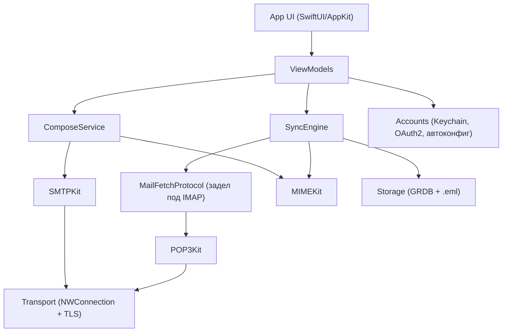

# План: собственный POP3/SMTP почтовый клиент для macOS

## 1. Стек разработки

- **Язык и UI:** Swift 6 и SwiftUI. Где SwiftUI не хватает, используем AppKit: таблицу писем, панель инструментов окна, `NSTextView` в редакторе. Минимальная версия: macOS 14 (Sonoma). Архитектура: Apple Silicon (arm64).
- **Сеть:** `Network.framework` (`NWConnection`). Он нативно поддерживает TLS и SSL, а для STARTTLS используем upgrade через `NWProtocolTLS`. POP3 и SMTP-клиент пишем сами: протоколы простые, а зрелых Swift-библиотек для POP3 нет. Запасной вариант: MailCore2 (Objective-C), он старый и тяжёлый.
- **MIME:** собственный модуль для разбора и сборки MIME:
  - multipart, base64, quoted-printable, RFC 2047 и RFC 2231 для имён файлов;
  - кодировки `koi8-r`, `windows-1251`, `utf-8` (критично для писем с mail.ru) через `CFStringConvertEncodingToNSStringEncoding`.
- **Хранение:**
  - SQLite через [GRDB.swift](https://github.com/groue/GRDB.swift): метаданные писем, папки, UIDL, полнотекстовый поиск FTS5;
  - исходные `.eml` файлы на диске в `~/Library/Application Support/<App>/`.
- **Секреты:** Keychain (Security.framework) для паролей и OAuth-токенов.
- **Отображение HTML:** `WKWebView` с блокировкой внешних картинок через `WKContentRuleList`. Это даёт кнопки «Load Remote Images: Always / Once» как на макете. JavaScript отключён.
- **OAuth2:** `ASWebAuthenticationSession` и PKCE, механизм `XOAUTH2` для POP3 и SMTP. Для Gmail нужен OAuth client в Google Cloud Console, для Outlook — регистрация приложения в Azure (Microsoft Entra).
- **Сборка проекта:** XcodeGen (`project.yml`), чтобы ИИ-агенты правили YAML, а не хрупкий `.pbxproj`. Модули оформляем как локальные Swift Package.
- **Локализация:** String Catalogs (`.xcstrings`), русский и английский с первого этапа. Каждая строка UI сразу получает перевод, наличие перевода проверяет `scripts/check-localizations.sh`. Язык переключается в настройках, применяется после перезапуска. Правила описаны в [AGENTS.md](../../AGENTS.md).

## 2. Что установить в систему

Состояние на 12.11.2026 (актуальные версии в [AGENTS.md](../../AGENTS.md)):

- [x] **Xcode 27.2** установлен и выбран через `xcode-select`.
- [x] `brew install xcodegen swiftlint swiftformat xcbeautify`.
- [x] **Docker.app** для тестов (вместо OrbStack).
- [x] **GreenMail** поднят через [docker-compose.yml](../../docker-compose.yml), SMTP и POP3S проверены.
- [x] Ящик mail.ru с паролем приложения «Vermail».
- [x] Git-репозиторий, remote `https://github.com/Vladimir-Etherlord/vermail`.
- **Локальный тестовый почтовый сервер** [GreenMail](https://greenmail-mail-test.github.io/greenmail/) в Docker. Он поддерживает POP3, SMTP и IMAP с TLS и позволяет гонять интеграционные тесты без реальных ящиков.
- **Apple ID в Xcode** (бесплатный) для локальной подписи. Платный Developer-аккаунт не нужен, пока не понадобятся iCloud или нотаризация.
- **Тестовые ящики** на mail.ru, yandex, gmail и outlook. На mail.ru и yandex нужно создать «пароль для внешнего приложения».

## 3. Архитектура

Модули (библиотеки внутри одного локального SPM-пакета `Packages/VermailKit`):

- **`MailTransport`:** соединение, TLS и STARTTLS, режим «разрешить недействительный сертификат», таймауты, логирование протокольного обмена.
- **`POP3Kit`:** команды USER/PASS, APOP, AUTH (PLAIN, LOGIN, CRAM-MD5, XOAUTH2), STAT, LIST, UIDL, TOP, RETR, DELE, CAPA, STLS.
- **`SMTPKit`:** EHLO, STARTTLS, AUTH (PLAIN, LOGIN, CRAM-MD5, XOAUTH2), MAIL FROM, RCPT TO, DATA, dot-stuffing.
- **`MIMEKit`:** парсер и билдер писем.
- **`MailStorage`:** схема БД, миграции, FTS-поиск.
- **`MailCore`** (своё имя, не путать с MailCore2): доменные модели `Account`, `Folder`, `Message`, а также протокол `MailFetching`, чтобы позже добавить `IMAPKit`.
- **`App`:** UI.

## 4. Особенности POP3, которые надо учесть

- POP3 видит только папку «Входящие» на сервере. Папки «Черновики», «Отправленные», «Корзина», «Спам», «Архив» и «Вся почта» с макета будут **локальными**.
- По UIDL отслеживаем уже скачанные письма. Настройки:
  - «оставлять копии на сервере»;
  - «удалять с сервера через N дней»;
  - «удалять с сервера при удалении из корзины».
- Отправленные письма сохраняем в локальную папку «Отправленные». mail.ru сам кладёт копию в «Отправленные» на сервере, но по POP3 её не видно.
- Встроенные пресеты серверов: mail.ru (`pop.mail.ru:995 SSL`, `smtp.mail.ru:465 SSL`), Yandex, Gmail, Outlook/Hotmail, iCloud, Rambler. Для остальных доменов: автоконфиг через Mozilla ISPDB (`autoconfig.thunderbird.net`) и подбор по DNS MX.

## 5. Объём MVP по экранам

- **Главное окно** (макет `tz/MainWindow.png`). Три колонки на `NavigationSplitView`:
  - аккаунты и папки, кнопка обновления;
  - список писем с аватаром и инициалами, отправителем, темой, превью, датой и значком вложения; переключатель «только непрочитанные», поиск;
  - просмотр письма: заголовки, HTML-тело, панель действий (ответить, ответить всем, переслать, удалить, переместить), блок вложений с Quick Look и сохранением.
- **Окно написания письма:**
  - поля «Кому», «Копия», «Скрытая копия» с автодополнением из истории;
  - выбор отправителя и псевдонима;
  - простой rich-text или plain-text редактор, вложения через drag-and-drop, подпись, сохранение черновика.
- **Настройки аккаунта** (макет `tz/SettingsWindow.png`), вкладки:
  - «Пользователь»: имя, описание, иконка и цвет, POP и SMTP с портом, шифрованием и типом аутентификации, кнопки «Тест POP» и «Тест SMTP»;
  - «Папки», «Псевдоним», «Подпись»;
  - «Ещё»: интервал проверки, оставлять на сервере, удалять через N дней.
  - Вкладку «Сопоставление» оставляем на этап IMAP.
- **Общие настройки** (макет из `tz/`, окно с боковым списком). В MVP разделы:
  - «Аккаунты»;
  - «Общие»: язык, единый ящик, звуки, иконка в Доке, уведомления, «отметить прочитанным через N сек», папка вложений;
  - «Составление»;
  - «Внешний вид»;
  - «Сообщения».
- **Мастер добавления аккаунта:** ввести email, затем автоопределение серверов, пароль или OAuth, проверка соединения.
- **Системное:** уведомления (`UserNotifications`), бейдж непрочитанных на иконке в Доке, проверка почты по таймеру и при пробуждении из сна, пункт в строке меню (опционально).

После MVP: правила, отложенные письма, «отправить позже», синхронизация через iCloud (нужен платный Developer-аккаунт), горячие клавиши, IMAP.

## 6. Как работать с ИИ-агентами

- [AGENTS.md](../../AGENTS.md) в корне описывает стек, структуру модулей, код-стайл, локализацию и команды. Полная проверка запускается одной командой `scripts/ci.sh`.
- Сначала протокольные модули с unit-тестами на записанных диалогах сервера, затем интеграционные тесты на GreenMail, и только потом UI. Так агенты могут проверять себя без ручного тестирования.
- Каждый этап делать отдельной небольшой задачей с проверяемым результатом: тесты зелёные, проект собирается.
