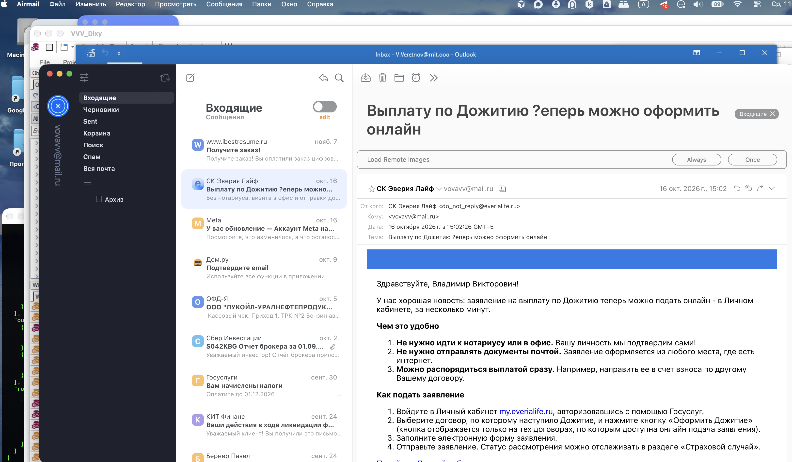

# Vermail

**Нативный почтовый клиент для macOS** — быстрый, понятный и без лишнего. Собирает почту из нескольких ящиков в общие папки и работает с популярными почтовыми сервисами, включая Mail.ru, Яндекс, Gmail и Outlook.

> **Статус:** ранняя разработка. Готов каркас приложения, идёт работа над сетевым слоем и протоколами.
> План и ход работ: [.cursor/plans/pop3_client_macos.plan.md](.cursor/plans/pop3_client_macos.plan.md).

<p align="center">
  
</p>

## Возможности

| | Что умеет (цель MVP) |
|---|---|
| **Несколько аккаунтов** | Письма со всех ящиков в общих папках «Входящие», «Отправленные» и др., плюс папки каждого аккаунта отдельно |
| **Протоколы** | POP3 и SMTP с SSL/TLS и STARTTLS; IMAP — следующий шаг. У каждого аккаунта свой протокол |
| **Безопасность** | Пароли и токены только в Связке ключей macOS, OAuth2 для Gmail и Outlook, пароли приложений для Mail.ru и Яндекса |
| **Приватность** | Внешние картинки в письмах заблокированы, пока вы не разрешите их загрузку |
| **Языки** | Русский и английский; новый язык добавляется переводом в каталог строк, без изменения кода |
| **Настройка** | Автоопределение серверов по адресу почты, готовые настройки для популярных сервисов |

## Требования

- macOS 14 Sonoma или новее, Apple Silicon
- Для сборки: Xcode 16+ и [Homebrew](https://brew.sh)

## Сборка

```bash
brew install xcodegen swiftlint swiftformat xcbeautify
git clone https://github.com/Vladimir-Etherlord/vermail.git && cd vermail
xcodegen generate
open Vermail.xcodeproj
```

Проект Xcode генерируется из [`project.yml`](project.yml), поэтому `Vermail.xcodeproj` в репозитории нет.

Полная проверка (форматирование, линтер, переводы, тесты) — одной командой:

```bash
scripts/ci.sh
```

Интеграционные тесты используют локальный почтовый сервер [GreenMail](https://greenmail-mail-test.github.io/greenmail/) в Docker: `docker compose up -d`.

## Устройство проекта

```text
Vermail/                 приложение на SwiftUI
VermailTests/            тесты приложения
Packages/VermailKit/     почтовое ядро, независимое от интерфейса
  MailCore               аккаунты, папки, общие модели
  MailTransport          TCP-соединения, SSL/TLS, STARTTLS
  POP3Kit · SMTPKit      почтовые протоколы
  MIMEKit                разбор и сборка писем
  MailStorage            локальная база писем
```

## Стек

Swift 6 · SwiftUI · AppKit · Swift Testing · SQLite ([GRDB](https://github.com/groue/GRDB.swift)) · XcodeGen

## Разработка с ИИ-агентами

Проект разрабатывается с помощью ИИ-агентов в [Cursor](https://cursor.com). Правила для агентов — стек, структура, локализация, команды — собраны в [AGENTS.md](AGENTS.md).
